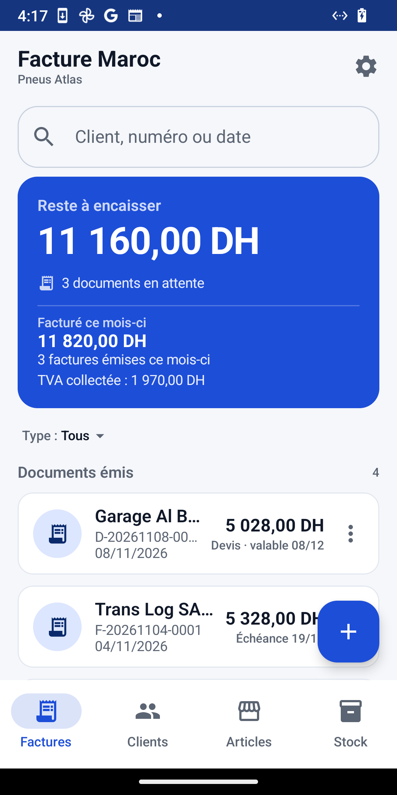

# Facture Maroc

**Facturation hors ligne pour les commerçants marocains.**
Factures, devis, bons de commande, tickets, avoirs, proformas, acomptes,
régularisations, factures simplifiées et factures à l'export — avec ICE, IF, RC,
patente, CNSS, TVA, montants en toutes lettres et mode auto-entrepreneur.

Version **0.12.0** (versionCode 23) · Android 8.0+ (minSdk 26) · Français.
Sur le Play Store : **0.11.1** (versionCode 18) tant que la 0.12.0 n'y est pas téléversée.

État du produit : [`docs/status.md`](docs/status.md) · Décisions :
[`docs/decisions.md`](docs/decisions.md) · Checklist de version :
[`docs/release-checklist.md`](docs/release-checklist.md).

## FactureApp — la version web

Le même moteur de facturation dans le navigateur, sur
**[factureapp.ma/app](https://factureapp.ma/app/)** : comptes, boutiques,
numérotation automatique, PDF archivé, paiements et relevés clients. Gratuit
jusqu'à 5 factures émises par mois ; plan Pro à 990 DH par an.

La webapp vit dans [`webapp/`](webapp/) (Vite + Svelte 5 + TypeScript +
Supabase) et se construit dans `docs/app/`. L'application Android reste
**hors ligne** : c'est le produit de terrain, la webapp est le produit vendu
(Google Play ne permet pas l'enregistrement marchand au Maroc).

Un générateur de facture marocaine sans compte est disponible sur
`/app/gratuit`.



## Ce que fait l’application

Trois onglets, pas de détour :

- **Factures** — brouillons et documents émis, total facturé du mois, recherche,
  duplication, suppression, export XML.
- **Clients** — carnet d’adresses avec adresse, ICE, IF, RC, patente, CNSS,
  téléphone et e-mail ; le client se remplit sur la facture en un tap. L’onglet
  tient les deux carnets sous les puces **Clients / Fournisseurs** : un
  fournisseur a les mêmes champs, et c’est lui qui remplit le bon de commande.
- **Articles** — votre **inventaire** : chaque produit porte sa quantité en stock,
  son prix d'achat, son prix de vente et son code-barres (tapé ou **scanné avec
  l'appareil photo**) ; les prestations n'ont
  pas de quantité. L'onglet ouvre **la liste entière**, triée par désignation, le
  chemin du dossier en sous-titre. Les **dossiers sont un filtre** (« Tous »,
  « Sans dossier », chaque dossier, et un menu pour les chemins complets) plutôt
  qu'un endroit où l'on entre : **ils s'imbriquent toujours** (les coussins
  se rangent sous Textile), et se créent, se renomment ou se suppriment depuis
  l'écran **Dossiers** du bandeau du haut.
  Un **glissement vers la gauche** sur une ligne découvre « déplacer » et
  « supprimer » sans ouvrir la fiche ; la barre du bas récapitule ce que le
  filtre contient (articles, unités, valeur d'achat du stock).
  Chaque commerce choisit ce que la fiche article lui demande — code-barres,
  prix d'achat, unité, stock, dossier — dans **Paramètres → Articles**. La
  quantité se saisit au clavier ou avec les boutons **− / +**. Masquer
  un champ ne l'efface pas : la valeur reste sur l'article et réapparaît si le
  champ est réactivé.

Le stock se met à jour tout seul : émettre une facture, un ticket, une facture
simplifiée ou un export retire les quantités vendues ; un avoir les remet ; un
devis, une proforma ou un bon de commande ne touche à rien. Supprimer une facture
émise remet le stock. Une ligne est reconnue par sa désignation : renommer un
article entre le brouillon et l'émission d'une facture empêche la déduction, et
c'est le seul cas où la quantité ne suit pas.

Dans le constructeur de document :

- **Type de document** : facture, devis, bon de commande, ticket 80 mm, avoir,
  proforma, acompte, régularisation, facture simplifiée, facture à l'export.
  Chacun a sa propre séquence de numérotation (`F-`, `D-`, `BC-`, `T-`, `A-`,
  `PF-`, `AC-`, `REG-`, `FS-`, `E-`).
- Un **bon de commande** est adressé au **fournisseur** : il prend la place du
  client sur le document, et le carnet des fournisseurs le propose. Un bon de
  commande sans fournisseur n’affiche pas de destinataire inventé.
- Lignes prises dans le catalogue ou **tapées à la main**, quantité et prix
  modifiables, remise par ligne et remise générale. La quantité accepte les
  **décimales** : 2,5 m, 1,5 kg, 0,75 heure s'impriment sans zéro inutile, et le
  stock reste compté en articles entiers (la quantité est arrondie, à l'unité,
  au moment de la déduction).
- **TVA par ligne** : 20 %, 10 %, 0 % ou exonérée, avec le **récapitulatif par
  taux** sur les six modèles et un sous-total par taux dans l'export UBL.
  **Exonération par ligne** et **mode auto-entrepreneur** (TVA non applicable sur
  tous les documents du magasin).
- **Prix HT ou TTC au choix** : le commerce décide s'il tape ses prix hors taxe
  (« TVA en sus ») ou taxe comprise (« TVA incluse »). La facture montre toujours
  HT + TVA, comme l'exige un document ; un prix tapé TTC est divisé une seule
  fois, à l'entrée, et ressort au centime près. Ce prix tapé reste sur la ligne :
  **changer de client le relit**, pour qu'un client exonéré paie le montant
  affiché et non 20 % de moins.
- Avoir, acompte et régularisation portent une **référence** ("Annule et
  remplace la facture N° …") ; l'export porte un **Incoterms** facultatif.
- **Montant total écrit en toutes lettres**, en français, avec l'ouverture
  adaptée au type de document.
- **Six modèles PDF** : **Classique** (sobre, sans couleur), **Moderne** (titre
  large et filet de couleur), **Facture Maroc** (grille TVA et mentions
  légales), **Épuré** (typographique, beaucoup de blanc), **Bandeau** (bandeaux
  de couleur en haut et en bas) et **Ticket** (rouleau 80 mm).
- L’écran **Modèle de document** montre les six rendus réels, laisse choisir la
  **couleur d’accent** (huit teintes) et règle ce qui s’imprime : logo,
  identifiants légaux, montant en lettres, mode de règlement, état du paiement,
  **QR de paiement** et pied de page. Chaque interrupteur change l’aperçu et le
  document.
- Logo du commerce, **téléphone et e-mail**, coordonnées et mentions légales sur
  chaque document.
- **Note au client, conditions de règlement et remerciement** : chaque bloc ne
  s'imprime que s'il est rempli. Le remerciement remplace la ligne de pied de
  page ; vide, la phrase habituelle revient.
- **Signature ou cachet** : dessinée au doigt dans un cadre, ou reprise d'une
  photo (recadrée à l'encre, 2 Mo maximum). Elle s'imprime sur les cinq modèles
  A4 ; le ticket 80 mm garde les notes mais pas la signature, illisible sur
  papier thermique.
- **Les coordonnées du commerce sont figées sur le document émis** : changer
  l'ICE, l'adresse, le logo ou le taux de TVA plus tard ne réécrit pas une
  facture déjà remise. Un brouillon, lui, suit les réglages du jour jusqu'à son
  émission. Le logo est stocké **une fois** par contenu (`files/logo-snapshots/`),
  le document ne garde que son empreinte.
- **Surcharge ou livraison** : un montant fixe ou un **pourcentage** du total
  remisé, avec son libellé, ajouté après la remise et avant la TVA. À zéro, la
  ligne disparaît des totaux.
- **Numérotation** : chaque type a sa séquence, son **préfixe réglable** (lettres,
  chiffres, `-`, `_`) et une **remise à zéro annuelle facultative**, éteinte par
  défaut. Le compteur de factures reste modifiable ; un document qui n'est pas
  parti rend son numéro.
- **Conditions de règlement** : comptant, 30 jours, 60 jours, fin de mois ou
  texte libre. Une présélection remplit la note — elle demande confirmation
  avant de remplacer un texte saisi à la main. La **clause de retard de
  paiement**, réglée une fois dans les paramètres, s'imprime sous les totaux
  seulement sur un document non comptant, et seulement si le magasin l'a
  remplie. Livrée comme **modèle** en français, à faire vérifier par le
  comptable.
- **Paiements** : depuis l'historique, « Encaisser… » enregistre un montant, une
  date, un moyen et une référence. Le document affiche alors « Payé … / Reste à
  payer … », ou « Facture acquittée le … » une fois soldé. L'état (impayée,
  partielle, payée) est calculé, jamais saisi ; un duplicata repart à zéro.
- **Reçus et relevés** : chaque paiement peut produire un **reçu A5** (somme
  reçue, moyen, référence, total payé et reste) ; la fiche client produit un
  **relevé de compte A4** (facturé, avoirs, payé, solde, échéances en retard).
- **Acompte déjà versé** : un montant et le numéro du document d'acompte sont
  déduits du **reste à payer**, jamais de la base de TVA ; le reçu et le relevé
  portent la même déduction.
- **Coordonnées bancaires et QR** : banque, RIB (24 chiffres, averti sans être
  bloqué) et titulaire s'impriment avec le bloc de paiement. Un **QR de paiement**
  facultatif, éteint par défaut, encode une ligne de paiement en texte clair
  (banque, RIB, montant dû, numéro) — jamais un lien.
- **Nom du fichier PDF** réglable (`facture_{number}` par défaut), assaini pour
  tous les systèmes de fichiers et toujours terminé par `.pdf` ; le reçu et le
  relevé passent par les mêmes règles.
- **Archive** : chaque PDF partagé et chaque XML exporté sont recopiés et
  enchaînés par empreinte. La fiche d'un document dit si son PDF y est
  réellement conservé, et l'écran Paramètres vérifie toute la chaîne.

Les documents sont générés en PDF dans le cache de l’application, puis remis au
sélecteur Android. Android ne dit pas si ce sélecteur a été utilisé ou refermé :
l’application demande donc **si le document est bien parti**. « Non » replace le
numéro dans la séquence et garde le brouillon tel quel ; « Oui » enregistre le
document dans l’historique et met le stock à jour. Rien n’est consommé avant la
réponse. L’application n’a **aucun accès à vos données** : elle ne
demande ni Internet, ni stockage, ni contacts. La seule permission est
**l’appareil photo**, et seulement pour lire le code-barres d’un article au
moment où vous touchez le bouton « scanner » ; refusez-la et le code se tape à
la main. La lecture se fait sur le téléphone, aucune image n’est enregistrée ni
envoyée.

## Confidentialité

- Aucun compte, aucune publicité, aucun traceur, aucun serveur.
- Les données restent dans l’espace privé de l’application.
- Les PDF, XML et sauvegardes ne sortent que sur une action de l’utilisateur.
- La sauvegarde automatique d’Android est **désactivée** par l’application :
  ni factures, ni articles, ni clients ne partent dans le compte Google ni dans
  un transfert d’appareil à appareil. Pour changer de téléphone, on passe par
  le fichier de sauvegarde de l’application (Paramètres → Sauvegarde), qu’on
  voit et qu’on garde.

Politique complète : [`docs/privacy.html`](docs/privacy.html) — publiée sur
Cloudflare Pages à l’adresse
`https://factureapp.ma/privacy.html`.

Le site public — présentation, captures, questions fréquentes et inscription des
testeurs — est publié depuis `docs/` :
`https://factureapp.ma/`. Les pages marketing sont en HTML et CSS seuls, sans
construction ni JavaScript, et n’appellent **aucune ressource externe**, polices
comprises : une page qui promet l’absence de réseau ne peut pas charger Google
Fonts. L’application web, servie sous `/app/`, est un bundle séparé et utilise
Supabase pour les comptes et les documents.

Trois pages éditoriales s’y ajoutent : [`docs/a-propos.html`](docs/a-propos.html),
[`docs/contact.html`](docs/contact.html) et le guide
[`docs/mentions-obligatoires-facture-maroc.html`](docs/mentions-obligatoires-facture-maroc.html).
`python3 docs/build.py` régénère le `sitemap.xml` (avec `lastmod` pris sur git)
et aligne la version affichée sur `app/build.gradle.kts` ;
`docs/scripts/site-check.sh` refuse une page sans titre unique, sans description,
sans canonical, sans `<h1>`, une image sans dimensions, un lien local mort ou un
budget de polices dépassé. Les polices sont sous-ensemblées par
`docs/scripts/fonts.sh` (75 Ko → 35 Ko pour Bricolage, 45 → 31 pour Plex Sans).

L’installation de la version de test est expliquée pas à pas sur
[`docs/test.html`](docs/test.html) : rejoindre le groupe
`facturemaroc-testeurs`, s’inscrire au test fermé, puis installer depuis Google
Play. La page ne publie aucune adresse personnelle — les retours passent par les
tickets GitHub.

> **Sauvegarde et restauration** : Android peut sauvegarder l’application, mais
> l’application fournit aussi son propre fichier de sauvegarde (Paramètres →
> Sauvegarde). Ce fichier contient toutes les données, **y compris les clients**,
> et n’est **pas chiffré**. Gardez-le dans un endroit sûr.

## Construire

Prérequis : JDK 21 et le SDK Android (compileSdk 36). Le projet utilise le
wrapper Gradle fourni.

```bash
export JAVA_HOME="$HOME/.local/jdk"      # ou votre JDK 21
./gradlew testDebugUnitTest             # 629 tests JVM
./gradlew assembleDebug                 # app/build/outputs/apk/debug/app-debug.apk
./gradlew bundleRelease                 # app/build/outputs/bundle/release/app-release.aab
./gradlew assembleRelease               # app/build/outputs/apk/release/app-release.apk
```

### Signature

La release est signée avec le keystore déclaré dans `keystore.properties`.
Ce fichier est **ignoré par Git** ; `keystore.properties.example` montre les
clés attendues. Ne commitez jamais le keystore ni ses mots de passe.

Le même keystore que la version 0.1.0 est utilisé, pour que les mises à jour
s’installent par-dessus l’application existante. Une rotation de mot de passe
`keytool -storepasswd` conserve le certificat et n’empêche pas les mises à jour.

## Tests

**629 tests JVM**, plus vingt tests instrumentés :

| Suite | Ce qu’elle protège |
|---|---|
| `AmountWordsTest` | Nombres en lettres, accords de « cent » et « vingt » devant mille, centimes, type de document |
| `InvoiceDataTest` | Sous-total, remise, TVA, exonération, arrondis au centime, destinataire d’un bon de commande |
| `InvoiceDesignTest` | Couleur d’accent lue sans planter, huit teintes distinctes, interrupteurs par défaut |
| `PdfTotalsTest` | Géométrie du bloc des totaux : le libellé s’arrête avant le montant |
| `PdfTextTest` | Montants et pourcentages à la française, adresse sur une ligne |
| `PageFlowTest` | Où couper une page, ce qui se répète en haut de la suivante |
| `InvoiceJsonTest` | Aller-retour JSON sans perdre un champ imprimé |
| `ShopSnapshotTest` | Les coordonnées figées à l’émission ne suivent pas les changements du magasin ; ancien JSON relu sans snapshot ; logo 0.9.0 encore lisible |
| `PaymentSurchargeTest` | Surcharge avant TVA, remise, exonération, plafonnement du paiement, états dérivés |
| `InvoiceArchiveTest` | … et un PDF partagé est stocké sous son empreinte et vérifié |
| `InvoiceValidationTest` | Champs obligatoires et blocage des documents incomplets |
| `InvoiceXmlTest` | UBL 2.1 : espaces de noms, codes de type, totaux, échappement, document relu par un parseur |
| `InvoiceArchiveTest` | Chaîne de hachage : modification, suppression, réordonnancement, document remplacé, journal illisible |
| `BackupTest` | Sauvegarde, restauration, compatibilité, plafond de taille, dossiers |
| `SavedItemTest` | Articles, dossiers, doublons, migration v1 → v3 |
| `StockMovementTest` | Ce qu'une émission retire du stock, ce qu'un devis ne touche pas, ce qu'un avoir remet |
| `PriceBasisTest` | HT ↔ TTC : conversion, aller-retour d'un prix, total au centime |
| `SavedItemSearchTest` | La recherche répond au code-barres, aux mots, à la casse et au dossier |
| `FolderPathTest` | Dossiers imbriqués : parent, enfants, sous-arbre, renommage, suppression, recherche profonde |
| `ItemFieldsTest` | Champs d'article activables : défauts, chaque interrupteur, filtre de dossier et sous-dossiers |
| `BarcodeTest` | Ce qui est gardé d'un code lu : ni saut de ligne, ni zéros perdus |
| `InvoiceSummaryTest` | Le total du mois exclut devis, bons de commande et brouillons |
| `PaymentTermsTest` | Présélections de règlement, document comptant, clause de retard jamais imprimée sur un comptant |
| `PaymentQrTextTest` | Le QR porte banque, RIB, montant et numéro — du texte, jamais une URL |
| `PdfFileNameTest` | Nom de PDF assaini, extension forcée, modèle vide encore utilisable |
| `DepositTest` | L'acompte réduit le reste à payer sans toucher à la TVA |
| `ClientStatementTest` | Relevé : facturé, avoirs, payé, solde, échéances en retard |
| `QuantityTest` | Quantités décimales : saisie, arrondi du stock, impression sans zéro |

Les captures Play utilisent un jeu de démonstration (« Atelier Atlas »), jamais
les données d’un client réel.

### Tests sur l’appareil

```bash
./gradlew connectedDebugAndroidTest   # 20 tests instrumentés
```

`InvoicePdfPagesTest` compte les feuilles d’un vrai PDF avec le lecteur
d’Android, pour chaque modèle : une vente de trois lignes tient sur une page, une
vente de quarante lignes se coupe en deux, **chaque feuille porte de l’encre** et
le rouleau 80 mm ne se coupe jamais. C’est le rendu et l’écrivain du PDF qui
s’accordent dans le même test — un modèle qui décide de paginer puis continue de
dessiner sur la première feuille passerait tous les tests JVM.

`BarcodeDecodeTest` ouvre un vrai EAN-13 (image livrée dans `androidTest/assets`,
produite par `python-barcode`, pas dessinée à la main), le fait décoder par le
même client ML Kit que le dialogue de scan, et vérifie que le code relu est
stocké tel quel. Le premier jet attendait un chiffre de contrôle inventé pour le
jeu de démonstration : le lecteur avait raison, le test était faux.

L’appareil photo lui-même ne se teste pas sans une caméra braquée sur une boîte :
ce qui reste à essayer à la main, c’est le viseur, et le fait qu’un scan ferme
bien le dialogue en laissant le champ rempli.

## Données et formats

Tout est local, en JSON ou dans les préférences Android :

- `filesDir/invoices.json` — brouillons et documents émis.
- `filesDir/saved_items.json` — inventaire et dossiers (format v3). Un dossier
  imbriqué s'écrit avec le chemin complet (`"Mobilier/Chaises"`), donc un catalogue
  écrit avant l'imbrication se relit tel quel.
- `filesDir/shop_logo.png` — logo copié depuis le sélecteur de photos.
- `filesDir/archive/ledger.jsonl` — chaîne de hachage des XML exportés.
- `filesDir/archive/documents/<sha256>.xml|.pdf` — copie exacte de chaque XML exporté et de chaque PDF partagé.
- `filesDir/backups/auto-AAAAMMJJ-HHMMSS.json` — sept copies automatiques
  quotidiennes, même format que la sauvegarde manuelle, lues par le même code.
- Préférences — commerce, clients, compteurs de numérotation, design.

**Sauvegarde** : un seul fichier JSON versionné (format 1) contenant commerce,
logo, clients, articles, dossiers, factures, compteurs et préférences. La
restauration valide le fichier puis remplace les données après confirmation.

**Sauvegarde automatique** : au premier lancement de la journée, l'application
écrit la même sauvegarde dans `files/backups`, en garde sept et se limite à
24 Mo. L'écran Paramètres liste ces copies et les restaure. Un dossier choisi
une fois (via le sélecteur système, autorisation persistante) reçoit en plus
une copie hors du téléphone, sans permission supplémentaire : c'est le
fournisseur de documents qui écrit. Les deux chemins passent par le même
constructeur que l'export manuel, donc une copie ne peut pas diverger.

**XML** : chaque export est écrit en **UBL 2.1**, le format que la DGI a retenu
pour la facturation électronique. Le type suit les codes UN/CEFACT 1001 (380
facture, 381 avoir, 384 régularisation, 386 devis et bon de commande), un avoir
est un `CreditNote` et non une facture, et la devise est `MAD`. L'export porte le
numéro définitif du document : un succès consomme le numéro et marque le
document comme émis, un échec le remet en place.

Le profil marocain de la DGI n'est pas encore publié : les champs qu'elle
rendra obligatoires, et la signature électronique, ne sont donc pas écrits. Le
fichier est du UBL 2.1 valide, pas encore du UBL « accepté par la DGI », et un
seul fichier — `invoice/InvoiceXml.kt` — sera à modifier quand le profil sortira.

**Archive** : chaque XML exporté et chaque PDF partagé sont recopiés dans `filesDir/archive/`, nommés par
son empreinte SHA-256 et enchaîné au précédent. Modifier, retirer ou réordonner
une ligne du journal, ou remplacer un document, est détecté. C'est une chaîne de
hachage et non une signature : elle prouve qu'un document n'a pas bougé depuis
son archivage, elle ne prouve pas qui l'a produit — une clé privée vivrait de
toute façon sur le même téléphone que celui qui peut réécrire l'archive.

## Structure

```
app/src/main/java/com/yassine/facturemaroc/
├── MainActivity.kt            navigation entre les trois onglets et le constructeur
├── data/                      modèles, stores JSON, sauvegarde, numérotation
├── invoice/                   rendu PDF (6 modèles), pagination, XML, validation
└── ui/                        Compose : accueil, constructeur, éditeurs, pickers
```

Architecture volontairement simple : une activité, Compose Material 3, des
`StateFlow` exposés par les stores, aucune injection de dépendances, aucune
base de données, aucun appel réseau.

## Limites connues

- Ce n’est **pas un logiciel de comptabilité certifié**. Les mentions
  obligatoires (ICE, IF, RC, patente, CNSS, TVA) doivent être validées par le
  comptable du commerce.
- Le suivi couvre les **paiements reçus par document** et le **relevé de compte
  par client** ; les relances automatiques ne sont pas encore écrites.
- Pas encore de synchronisation cloud ni de connexion Google. Une sauvegarde
  cloud facultative viendra plus tard, dans une version séparée, avec sa propre
  mise à jour de la politique de confidentialité.
- L'export XML est du **UBL 2.1 standard**, sans le profil marocain de la DGI
  (non publié) et sans signature électronique : aucune plateforme de
  dématérialisation ne l'accepte encore, et rien dans l'application ne prétend
  le contraire. L'archive détecte une modification, elle n'authentifie pas
  l'auteur du document.
- Application mono-appareil ; le transfert passe par le fichier de sauvegarde.
- Interface en français uniquement.

## Play Store

Les ressources sont prêtes dans `play_store/` :

- `icon-512.png`, `feature-graphic-1024x500.png` ;
- `screenshots/` — quatre captures 1080 × 2160 ;
- `listing-fr.md` — titre, descriptions, catégorie, Data Safety, classification.

Le compte Play Console est vérifié depuis le 30 octobre 2026. L’AAB signé se
construit avec `./gradlew :app:bundleRelease`
(`app/build/outputs/bundle/release/app-release.aab`) ; il cible l’API 36, le
minimum exigé par Google pour toute nouvelle application depuis le
31 août 2026. Vérifier que l’adresse e-mail de contact (obligatoire et vérifiée
par Google) est bien saisie dans Play Console.

## Historique

- **0.11.1** — corrections de l'audit du 10 novembre : un document garde
  l'historique de ses encaissements (un reçu par paiement, dialogue prérempli
  avec le reste à payer) et seuls facture, ticket, simplifiée et export sont
  encaissables ; les paliers de prix suivent la base de la boutique (TTC ou HT)
  et ne sont plus divisés deux fois ; un catalogue ou un registre illisible est
  mis de côté au lieu d'être écrasé, un hash de logo doit être un vrai hash, et
  une écriture qui échoue est signalée ; le relevé compte l'acompte une seule
  fois, l'avoir ne le recopie plus, le CSV comptable écrit les avoirs en négatif
  avec le statut « Avoir » et la marge tient compte de la remise générale ;
  un avoir s'affiche en négatif, sans échéance et jamais en retard ; les coûts
  du catalogue sont lus en une passe ; le plafond de sauvegarde passe à 16 Mo
  et la sauvegarde Android est désactivée — rien ne quitte le téléphone.

- **0.11.0** — facturation complète et stock : TVA par ligne et
  récapitulatif par taux, remise en dirhams, surcharge en pourcentage, échéance
  de paiement, encaissements partiels, reçus et relevés, avoir en un geste,
  devis converti, acompte déduit, documents émis non supprimables, numérotation
  par type avec préfixe et remise à zéro annuelle, quantités décimales,
  conditions de règlement présélectionnées, clause de retard de paiement,
  coordonnées bancaires et QR facultatif, nom de PDF réglable et visibilité de
  l'archive sur chaque fiche. Côté stock : journal des mouvements et historique
  par article, inventaire avec écarts motivés, seuil de réapprovisionnement,
  bons de réception, valorisation CMP/FIFO, coût figé sur les lignes, marge par
  article et par mois, paliers de prix par quantité, attributs libres, TVA du
  mois par taux et export comptable en CSV. Le rappel de paiement se partage en
  texte depuis la fiche d'une facture non soldée.
- **0.10.0** — paiements encaissés (partiels), surcharge de livraison, logo
  stocké une fois par contenu, PDF partagés dans l'archive vérifiable.
- **0.8.2** — exemples génériques. Les écrans vides, les brouillons, les
  dossiers de stock et la recherche d’articles ne parlent plus de pneus : ils
  montrent une chaise en rotin, une livraison et un montage, comme n’importe
  quel commerce. Aucun changement de comportement.
- **0.8.1** — lisibilité et sauvegarde automatique.
  **Grands textes** : à 150 % la fiche article tronquait le nom dès le premier
  mot (« Chaise en rotin… ») ; la désignation tient maintenant sur deux lignes et
  le prix garde une largeur plancher. **Accessibilité** : les titres d'écran
  sont des en-têtes pour TalkBack, les actions du glissement nomment l'article
  (« Déplacer "Chaise en rotin" »), et la puce du dossier filtré se décoche au
  lieu de ne rien faire. L'état des écrans suit le cycle de vie
  (`collectAsStateWithLifecycle`) au lieu de collecter en arrière-plan.
  **Sauvegarde automatique** : une copie par jour au premier lancement, sept
  gardées sur le téléphone, restaurables depuis Paramètres ; un dossier choisi
  une fois reçoit en plus une copie hors du téléphone, sans nouvelle
  permission. Le tout passe par le même constructeur que l'export manuel.
  Trois tests d'interface Compose couvrent la règle « masquer n'efface pas »,
  et quelques aperçus (`@Preview`) rendent la carte article visible sans
  lancer l'application.
- **0.8.0** — l'onglet Articles s'ouvre sur **une liste plate** de tout le
  catalogue, triée par désignation, le chemin du dossier en sous-titre ; les
  **dossiers deviennent un filtre** (`Tous`, `Sans dossier`, chaque dossier, et
  un menu pour les chemins complets, sous-dossiers inclus). Ils restent une
  vraie arborescence : création, renommage et suppression vivent dans l'écran
  **Dossiers** du bandeau, atteint en un tap. La recherche depuis la liste plate
  parcourt tout le catalogue, code-barres compris, et le compteur du titre suit
  la recherche au lieu du catalogue.
  Une ligne se fait glisser vers la gauche pour la **déplacer** dans un dossier
  ou la **supprimer**, et la barre sous la liste compte les articles, les unités
  et la valeur d'achat du stock affiché. La quantité se saisit aussi avec les
  boutons − / +.
  Chaque commerce choisit les champs de la fiche article — **code-barres, prix
  d'achat, unité, stock, dossier** — dans **Paramètres → Articles** ; les cinq
  sont actifs par défaut, donc une installation existante ne voit rien changer.
  **Masquer un champ n'efface rien** : la valeur reste sur l'article et revient
  quand le champ est réactivé (un stock masqué ne transforme pas un produit en
  prestation à la première modification). Les cinq réglages passent dans la
  sauvegarde, et une sauvegarde antérieure restaure tout visible.
- **0.7.3** — audit complet du code avant la mise en ligne, sept défauts
  corrigés, tous dans la même zone : un prix que le client a lu sur l'écran et
  qui ressort différent sur le document.
  **La case « ligne exonérée de TVA » réinterprétait le prix tapé** : elle était
  lue sur l'état de la ligne *à l'ouverture* de la boîte de dialogue, pas sur
  l'interrupteur. Cocher « exonérée » sur `150 DH TTC` divisait donc par 1,20 et
  le client recevait 125 DH ; décocher laissait une ligne qui n'était plus
  exonérée facturer le prix HT **plus** la TVA. La conversion suit maintenant
  l'interrupteur, et le prix tapé est conservé (`150 DH` reste `150 DH`, avec ou
  sans TVA dedans).
  **Changer le taux de TVA ne recalculait pas les lignes déjà tapées** : un
  brouillon saisi à 20 %, corrigé à 10 %, imprimait un HT qui ne correspondait
  plus au prix annoncé, et le total bougeait d'autant. Le prix d'origine est sur
  la ligne, il est donc relu au taux courant — et **le brouillon est relu aussi
  quand on le rouvre**, sinon le vieux HT revenait avec le nouveau taux appliqué
  par-dessus (un article à 1680 DH affichait 1832,73 DH).
  **Une liste de factures illisible se faisait écraser** : le chargement
  renvoyait une liste vide et l'enregistrement suivant réécrivait le fichier.
  L'original est désormais mis de côté (`invoices.json-corrompu.json`) et les
  documents illisibles sont signalés dans le journal.
  **Le ticket 80 mm coupait la quantité** : la colonne faisait 11 points, donc
  « 120 » s'imprimait « 1… ». Elle est mesurée sur la plus longue quantité du
  ticket. Le panneau de détail montre les mêmes totaux que le papier —
  « Sous-total HT », « Remise x % » avec son montant, « Total HT » — au lieu de
  deux HT différents pour la même facture. Enfin le doublon mort de
  `ShopSettingsStore.write` et son `StateFlow` fantôme sont supprimés.
- **0.7.2** — **la promesse « aucun accès à Internet » était fausse**, et c'est
  la préparation de la fiche Play Store qui l'a révélé : le manifeste fusionné
  demandait `INTERNET` et `ACCESS_NETWORK_STATE`. Ils ne venaient d'aucune ligne
  du projet mais de `com.google.android.datatransport` (`transport-runtime`,
  `transport-backend-cct`), la bibliothèque que ML Kit utilise pour **envoyer ses
  journaux d'usage à Google** ; elle se déclare dans son propre manifeste, donc
  elle entrait dans l'application sans qu'on l'écrive nulle part. Les deux
  permissions sont maintenant retirées au moment de la fusion
  (`tools:node="remove"`), et la reconnaissance du code-barres n'en souffre pas :
  le modèle embarqué lit sur l'appareil, sans réseau. La fiche Play Store, la
  politique de confidentialité et le formulaire Sécurité des données disent donc
  désormais la vérité. **La seule permission reste `CAMERA`.**
- **0.7.1** — corrections trouvées en relisant le code source de bout en bout,
  toutes capables de mettre un chiffre faux sous les yeux d'un client.
  **Enregistrer les paramètres remettait le compteur de factures à 1** : changer
  le logo réattribuait `F-…-0001` au document suivant. **Fermer le sélecteur de
  partage émettait la facture** : le brouillon disparaissait, le stock bougeait et
  le numéro était dépensé pour un document que personne n'avait envoyé —
  l'application demande maintenant « Document envoyé ? », et « Non » garde le
  brouillon et rend le numéro. **Les lignes imprimées ne s'additionnaient pas au
  sous-total** (trois fois `99,99 TTC` donnaient 249,98 en face de trois `83,33`)
  et **un prix TTC dépendait du client présent au moment où la ligne était
  ajoutée** : il est désormais mémorisé et relu quand le client change.
  Ensuite, sept défauts plus silencieux : renommer un article ou un client
  **écrasait la fiche qui portait déjà ce nom** (et sa quantité en stock) ; le
  **total du mois** ignorait les factures simplifiées et à l'export et ne
  retranchait pas les avoirs ; le **XML d'un bon de commande** nommait le client
  là où le papier nomme le fournisseur ; **Template Maroc** imprimait les
  identifiants du client même interrupteur coupé ; l'**archive** se déclarait
  intacte quand son journal avait été supprimé ; la **sauvegarde** pouvait
  produire un fichier que l'application refusait ensuite de restaurer ; et le
  contrôle de total comparait une valeur avec elle-même.
- **0.7.0** — **refonte des modèles** : six rendus au lieu de quatre — Classique
  (sobre, sans couleur), Moderne et Facture Maroc (les deux repris des gabarits
  de l'application précédente), Épuré, Bandeau et le Ticket 80 mm —, tous **paginés** quand la vente
  dépasse une feuille, avec l'en-tête du document répété et `Page 1 / 2` au pied ;
  l'écran **Modèle de document** montre les six rendus réels (pas des vignettes
  dessinées), laisse choisir la **couleur d'accent** parmi huit teintes et règle
  cinq interrupteurs — logo, identifiants légaux, montant en lettres, mode de
  règlement, pied de page — qui changent l'aperçu et le document ; **les
  fournisseurs deviennent des tiers à part entière** : même fiche que les clients
  (ICE, IF, RC, patente, CNSS, téléphone, e-mail), onglet Clients scindé en
  Clients / Fournisseurs, un bon de commande adressé au fournisseur sans jamais
  retomber sur le nom du magasin, et une icône « bon de commande » sur sa fiche ;
  téléphone et e-mail du magasin imprimés ; « vingt » et « cent » ne prennent plus
  leur *s* devant *mille* (80 000 se lit « quatre-vingt mille »).
- **0.6.0** — **inventaire** : quantité en stock, prix d'achat (marge affichée) et
  code-barres par article, prestations sans quantité ; les articles vivent dans
  une **grille de dossiers** qu'on ouvre et qu'on quitte comme dans un gestionnaire
  de fichiers, et **les dossiers s'imbriquent** (un sous-dossier sous Mobilier pour
  les chaises, sans limite de profondeur) — un dossier affiche le total de tout son
  contenu, la recherche descend dans les sous-dossiers, renommer déplace tout le
  sous-arbre et supprimer remonte les articles d'un cran au lieu de les perdre ;
  **le stock suit les documents émis** (facture, ticket, simplifiée,
  export retirent, avoir remet, devis/proforma/bon de commande ne touchent rien) ;
  **prix HT ou TTC** au choix du commerce, converti une fois à l'entrée pour que
  la facture reste HT + TVA et que le total retombe sur le prix annoncé ;
  **lecture du code-barres à l'appareil photo** (la seule permission demandée,
  et seulement au moment du scan : le code se tape aussi à la main, la lecture
  se fait sur le téléphone et aucune image ne sort).
- **0.5.0** — export **UBL 2.1**, le format retenu par la DGI : avoir émis en
  `CreditNote`, codes de type UN/CEFACT, unités et moyens de paiement codés,
  TVA ventilée par taux au lieu d'une moyenne, exonération déclarée comme telle
  plutôt qu'un taux à 0 % ; **archive inviolable** des XML exportés (chaîne
  SHA-256 et copie des fichiers) ; `targetSdk` 36.
- **0.4.0** — nouveaux types de document : avoir, proforma, acompte,
  régularisation, facture simplifiée, facture à l'export, chacun avec sa propre
  numérotation ; référence ("Annule et remplace la facture N° …") sur les avoirs,
  acomptes et régularisations ; Incoterms sur l'export ; montant en toutes
  lettres adapté au type de document ; mode auto-entrepreneur (TVA non
  applicable).
- **0.3.0** — refonte en trois onglets, constructeur unique, clients et articles
  enregistrés, dossiers, validation, export XML, sauvegarde/restauration locale,
  nouvelle icône et ressources Play.
- **0.1.0** — première version fonctionnelle : documents, PDF, montant en
  lettres, modèles, logo et mentions légales.
