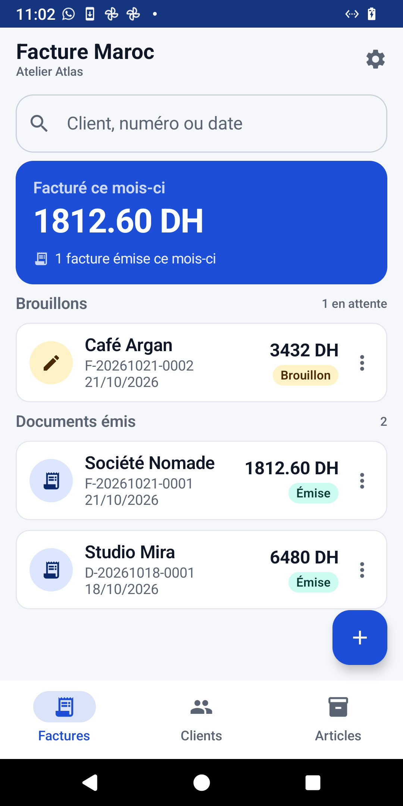

# Facture Maroc

**Facturation hors ligne pour les commerçants marocains.**
Factures, devis, bons de commande, tickets, avoirs, proformas, acomptes,
régularisations, factures simplifiées et factures à l'export — avec ICE, IF, RC,
patente, CNSS, TVA, montants en toutes lettres et mode auto-entrepreneur.

Version **0.7.1** (versionCode 9) · Android 8.0+ (minSdk 26) · Français.



## Ce que fait l’application

Trois onglets, pas de détour :

- **Factures** — brouillons et documents émis, total facturé du mois, recherche,
  duplication, suppression, export XML.
- **Clients** — carnet d’adresses avec adresse, ICE, IF, RC, patente, CNSS,
  téléphone et e-mail ; le client se remplit sur la facture en un tap. L’onglet
  tient les deux carnets sous les puces **Clients / Fournisseurs** : un
  fournisseur a les mêmes champs, et c’est lui qui remplit le bon de commande.
- **Articles** — votre **inventaire** : chaque produit porte sa quantité en stock,
  son prix d'achat, son prix de vente et son code-barres (tapé ou **scanné avec
  l'appareil photo**) ; les prestations n'ont
  pas de quantité. Le tout **rangé en dossiers** (« Pneus », « Prestations », ou
  tout autre dossier créé par le commerce), et **un dossier peut en contenir un
  autre** : les pneus d'hiver se rangent sous Pneus, et le fil d'Ariane rappelle
  où l'on est. Un dossier s'ouvre comme dans une application de fichiers et se
  referme par la flèche retour, un niveau à la fois.

Le stock se met à jour tout seul : émettre une facture, un ticket, une facture
simplifiée ou un export retire les quantités vendues ; un avoir les remet ; un
devis, une proforma ou un bon de commande ne touche à rien. Supprimer une facture
émise remet le stock. Une ligne est reconnue par sa désignation : renommer un
article entre le brouillon et l'émission d'une facture empêche la déduction, et
c'est le seul cas où la quantité ne suit pas.

Dans le constructeur de document :

- **Type de document** : facture, devis, bon de commande, ticket 80 mm, avoir,
  proforma, acompte, régularisation, facture simplifiée, facture à l'export.
  Chacun a sa propre séquence de numérotation (`F-`, `D-`, `BC-`, `T-`, `A-`,
  `PF-`, `AC-`, `REG-`, `FS-`, `E-`).
- Un **bon de commande** est adressé au **fournisseur** : il prend la place du
  client sur le document, et le carnet des fournisseurs le propose. Un bon de
  commande sans fournisseur n’affiche pas de destinataire inventé.
- Lignes prises dans le catalogue ou **tapées à la main**, quantité et prix
  modifiables, remise par ligne et remise générale.
- **TVA configurable** (20 % par défaut), **exonération par ligne** et **mode
  auto-entrepreneur** (TVA non applicable sur tous les documents du magasin).
- **Prix HT ou TTC au choix** : le commerce décide s'il tape ses prix hors taxe
  (« TVA en sus ») ou taxe comprise (« TVA incluse »). La facture montre toujours
  HT + TVA, comme l'exige un document ; un prix tapé TTC est divisé une seule
  fois, à l'entrée, et ressort au centime près. Ce prix tapé reste sur la ligne :
  **changer de client le relit**, pour qu'un client exonéré paie le montant
  affiché et non 20 % de moins.
- Avoir, acompte et régularisation portent une **référence** ("Annule et
  remplace la facture N° …") ; l'export porte un **Incoterms** facultatif.
- **Montant total écrit en toutes lettres**, en français, avec l'ouverture
  adaptée au type de document.
- **Six modèles PDF** : **Classique** (sobre, sans couleur), **Moderne** (titre
  large et filet de couleur), **Facture Maroc** (grille TVA et mentions
  légales), **Épuré** (typographique, beaucoup de blanc), **Bandeau** (bandeaux
  de couleur en haut et en bas) et **Ticket** (rouleau 80 mm).
- L’écran **Modèle de document** montre les six rendus réels, laisse choisir la
  **couleur d’accent** (huit teintes) et règle ce qui s’imprime : logo,
  identifiants légaux, montant en lettres, mode de règlement, pied de page.
  Chaque interrupteur change l’aperçu et le document.
- Logo du commerce, **téléphone et e-mail**, coordonnées et mentions légales sur
  chaque document.

Les documents sont générés en PDF dans le cache de l’application, puis remis au
sélecteur Android. Android ne dit pas si ce sélecteur a été utilisé ou refermé :
l’application demande donc **si le document est bien parti**. « Non » replace le
numéro dans la séquence et garde le brouillon tel quel ; « Oui » enregistre le
document dans l’historique et met le stock à jour. Rien n’est consommé avant la
réponse. L’application n’a **aucun accès à vos données** : elle ne
demande ni Internet, ni stockage, ni contacts. La seule permission est
**l’appareil photo**, et seulement pour lire le code-barres d’un article au
moment où vous touchez le bouton « scanner » ; refusez-la et le code se tape à
la main. La lecture se fait sur le téléphone, aucune image n’est enregistrée ni
envoyée.

## Confidentialité

- Aucun compte, aucune publicité, aucun traceur, aucun serveur.
- Les données restent dans l’espace privé de l’application.
- Les PDF, XML et sauvegardes ne sortent que sur une action de l’utilisateur.
- La sauvegarde automatique d’Android, si elle est activée sur le téléphone,
  peut copier les données dans le compte Google de l’utilisateur ; c’est le
  système Android qui la gère, pas l’application.

Politique complète : [`docs/privacy.html`](docs/privacy.html) — publiée sur
GitHub Pages à l’adresse
`https://beav0team.github.io/facture-maroc/privacy.html`.

> **Sauvegarde et restauration** : Android peut sauvegarder l’application, mais
> l’application fournit aussi son propre fichier de sauvegarde (Paramètres →
> Sauvegarde). Ce fichier contient toutes les données, **y compris les clients**,
> et n’est **pas chiffré**. Gardez-le dans un endroit sûr.

## Construire

Prérequis : JDK 21 et le SDK Android (compileSdk 36). Le projet utilise le
wrapper Gradle fourni.

```bash
export JAVA_HOME="$HOME/.local/jdk"      # ou votre JDK 21
./gradlew testDebugUnitTest             # 223 tests JVM
./gradlew assembleDebug                 # app/build/outputs/apk/debug/app-debug.apk
./gradlew bundleRelease                 # app/build/outputs/bundle/release/app-release.aab
./gradlew assembleRelease               # app/build/outputs/apk/release/app-release.apk
```

### Signature

La release est signée avec le keystore déclaré dans `keystore.properties`.
Ce fichier est **ignoré par Git** ; `keystore.properties.example` montre les
clés attendues. Ne commitez jamais le keystore ni ses mots de passe.

Le même keystore que la version 0.1.0 est utilisé, pour que les mises à jour
s’installent par-dessus l’application existante. Une rotation de mot de passe
`keytool -storepasswd` conserve le certificat et n’empêche pas les mises à jour.

## Tests

**223 tests JVM**, plus sept tests instrumentés :

| Suite | Ce qu’elle protège |
|---|---|
| `AmountWordsTest` | Nombres en lettres, accords de « cent » et « vingt » devant mille, centimes, type de document |
| `InvoiceDataTest` | Sous-total, remise, TVA, exonération, arrondis au centime, destinataire d’un bon de commande |
| `InvoiceDesignTest` | Couleur d’accent lue sans planter, huit teintes distinctes, interrupteurs par défaut |
| `PdfTotalsTest` | Géométrie du bloc des totaux : le libellé s’arrête avant le montant |
| `PdfTextTest` | Montants et pourcentages à la française, adresse sur une ligne |
| `PageFlowTest` | Où couper une page, ce qui se répète en haut de la suivante |
| `InvoiceJsonTest` | Aller-retour JSON sans perdre un champ imprimé |
| `InvoiceValidationTest` | Champs obligatoires et blocage des documents incomplets |
| `InvoiceXmlTest` | UBL 2.1 : espaces de noms, codes de type, totaux, échappement, document relu par un parseur |
| `InvoiceArchiveTest` | Chaîne de hachage : modification, suppression, réordonnancement, document remplacé, journal illisible |
| `BackupTest` | Sauvegarde, restauration, compatibilité, plafond de taille, dossiers |
| `SavedItemTest` | Articles, dossiers, doublons, migration v1 → v3 |
| `StockMovementTest` | Ce qu'une émission retire du stock, ce qu'un devis ne touche pas, ce qu'un avoir remet |
| `PriceBasisTest` | HT ↔ TTC : conversion, aller-retour d'un prix, total au centime |
| `SavedItemSearchTest` | La recherche répond au code-barres, aux mots, à la casse et au dossier |
| `FolderPathTest` | Dossiers imbriqués : parent, enfants, sous-arbre, renommage, suppression, recherche profonde |
| `BarcodeTest` | Ce qui est gardé d'un code lu : ni saut de ligne, ni zéros perdus |
| `InvoiceSummaryTest` | Le total du mois exclut devis, bons de commande et brouillons |

Les captures Play utilisent un jeu de démonstration (« Atelier Atlas »), jamais
les données d’un client réel.

### Tests sur l’appareil

```bash
./gradlew connectedDebugAndroidTest   # 7 tests instrumentés
```

`InvoicePdfPagesTest` compte les feuilles d’un vrai PDF avec le lecteur
d’Android, pour chaque modèle : une vente de trois lignes tient sur une page, une
vente de quarante lignes se coupe en deux, **chaque feuille porte de l’encre** et
le rouleau 80 mm ne se coupe jamais. C’est le rendu et l’écrivain du PDF qui
s’accordent dans le même test — un modèle qui décide de paginer puis continue de
dessiner sur la première feuille passerait tous les tests JVM.

`BarcodeDecodeTest` ouvre un vrai EAN-13 (image livrée dans `androidTest/assets`,
produite par `python-barcode`, pas dessinée à la main), le fait décoder par le
même client ML Kit que le dialogue de scan, et vérifie que le code relu est
stocké tel quel. Le premier jet attendait un chiffre de contrôle inventé pour le
jeu de démonstration : le lecteur avait raison, le test était faux.

L’appareil photo lui-même ne se teste pas sans une caméra braquée sur une boîte :
ce qui reste à essayer à la main, c’est le viseur, et le fait qu’un scan ferme
bien le dialogue en laissant le champ rempli.

## Données et formats

Tout est local, en JSON ou dans les préférences Android :

- `filesDir/invoices.json` — brouillons et documents émis.
- `filesDir/saved_items.json` — inventaire et dossiers (format v3). Un dossier
  imbriqué s'écrit avec le chemin complet (`"Pneus/Hiver"`), donc un catalogue
  écrit avant l'imbrication se relit tel quel.
- `filesDir/shop_logo.png` — logo copié depuis le sélecteur de photos.
- `filesDir/archive/ledger.jsonl` — chaîne de hachage des XML exportés.
- `filesDir/archive/documents/<sha256>.xml` — copie exacte de chaque XML exporté.
- Préférences — commerce, clients, compteurs de numérotation, design.

**Sauvegarde** : un seul fichier JSON versionné (format 1) contenant commerce,
logo, clients, articles, dossiers, factures, compteurs et préférences. La
restauration valide le fichier puis remplace les données après confirmation.

**XML** : chaque export est écrit en **UBL 2.1**, le format que la DGI a retenu
pour la facturation électronique. Le type suit les codes UN/CEFACT 1001 (380
facture, 381 avoir, 384 régularisation, 386 devis et bon de commande), un avoir
est un `CreditNote` et non une facture, et la devise est `MAD`. L'export porte le
numéro définitif du document : un succès consomme le numéro et marque le
document comme émis, un échec le remet en place.

Le profil marocain de la DGI n'est pas encore publié : les champs qu'elle
rendra obligatoires, et la signature électronique, ne sont donc pas écrits. Le
fichier est du UBL 2.1 valide, pas encore du UBL « accepté par la DGI », et un
seul fichier — `invoice/InvoiceXml.kt` — sera à modifier quand le profil sortira.

**Archive** : chaque XML exporté est recopié dans `filesDir/archive/`, nommé par
son empreinte SHA-256 et enchaîné au précédent. Modifier, retirer ou réordonner
une ligne du journal, ou remplacer un document, est détecté. C'est une chaîne de
hachage et non une signature : elle prouve qu'un document n'a pas bougé depuis
son archivage, elle ne prouve pas qui l'a produit — une clé privée vivrait de
toute façon sur le même téléphone que celui qui peut réécrire l'archive.

## Structure

```
app/src/main/java/com/yassine/facturemaroc/
├── MainActivity.kt            navigation entre les trois onglets et le constructeur
├── data/                      modèles, stores JSON, sauvegarde, numérotation
├── invoice/                   rendu PDF (6 modèles), pagination, XML, validation
└── ui/                        Compose : accueil, constructeur, éditeurs, pickers
```

Architecture volontairement simple : une activité, Compose Material 3, des
`StateFlow` exposés par les stores, aucune injection de dépendances, aucune
base de données, aucun appel réseau.

## Limites connues

- Ce n’est **pas un logiciel de comptabilité certifié**. Les mentions
  obligatoires (ICE, IF, RC, patente, CNSS, TVA) doivent être validées par le
  comptable du commerce.
- Pas de suivi des paiements, de crédit client ni de rapports : choix de
  périmètre de cette version.
- Pas encore de synchronisation cloud ni de connexion Google. Une sauvegarde
  cloud facultative viendra plus tard, dans une version séparée, avec sa propre
  mise à jour de la politique de confidentialité.
- L'export XML est du **UBL 2.1 standard**, sans le profil marocain de la DGI
  (non publié) et sans signature électronique : aucune plateforme de
  dématérialisation ne l'accepte encore, et rien dans l'application ne prétend
  le contraire. L'archive détecte une modification, elle n'authentifie pas
  l'auteur du document.
- Application mono-appareil ; le transfert passe par le fichier de sauvegarde.
- Interface en français uniquement.

## Play Store

Les ressources sont prêtes dans `play_store/` :

- `icon-512.png`, `feature-graphic-1024x500.png` ;
- `screenshots/` — quatre captures 1080 × 2160 ;
- `listing-fr.md` — titre, descriptions, catégorie, Data Safety, classification.

Le compte Play Console est vérifié depuis le 30 octobre 2026. L’AAB signé se
construit avec `./gradlew :app:bundleRelease`
(`app/build/outputs/bundle/release/app-release.aab`) ; il cible l’API 36, le
minimum exigé par Google pour toute nouvelle application depuis le
31 août 2026. Il reste à saisir l’adresse e-mail de contact (obligatoire et
vérifiée par Google) dans Play Console.

## Historique

- **0.7.2** — **la promesse « aucun accès à Internet » était fausse**, et c'est
  la préparation de la fiche Play Store qui l'a révélé : le manifeste fusionné
  demandait `INTERNET` et `ACCESS_NETWORK_STATE`. Ils ne venaient d'aucune ligne
  du projet mais de `com.google.android.datatransport` (`transport-runtime`,
  `transport-backend-cct`), la bibliothèque que ML Kit utilise pour **envoyer ses
  journaux d'usage à Google** ; elle se déclare dans son propre manifeste, donc
  elle entrait dans l'application sans qu'on l'écrive nulle part. Les deux
  permissions sont maintenant retirées au moment de la fusion
  (`tools:node="remove"`), et la reconnaissance du code-barres n'en souffre pas :
  le modèle embarqué lit sur l'appareil, sans réseau. La fiche Play Store, la
  politique de confidentialité et le formulaire Sécurité des données disent donc
  désormais la vérité. **La seule permission reste `CAMERA`.**
- **0.7.1** — corrections trouvées en relisant le code source de bout en bout,
  toutes capables de mettre un chiffre faux sous les yeux d'un client.
  **Enregistrer les paramètres remettait le compteur de factures à 1** : changer
  le logo réattribuait `F-…-0001` au document suivant. **Fermer le sélecteur de
  partage émettait la facture** : le brouillon disparaissait, le stock bougeait et
  le numéro était dépensé pour un document que personne n'avait envoyé —
  l'application demande maintenant « Document envoyé ? », et « Non » garde le
  brouillon et rend le numéro. **Les lignes imprimées ne s'additionnaient pas au
  sous-total** (trois fois `99,99 TTC` donnaient 249,98 en face de trois `83,33`)
  et **un prix TTC dépendait du client présent au moment où la ligne était
  ajoutée** : il est désormais mémorisé et relu quand le client change.
  Ensuite, sept défauts plus silencieux : renommer un article ou un client
  **écrasait la fiche qui portait déjà ce nom** (et sa quantité en stock) ; le
  **total du mois** ignorait les factures simplifiées et à l'export et ne
  retranchait pas les avoirs ; le **XML d'un bon de commande** nommait le client
  là où le papier nomme le fournisseur ; **Template Maroc** imprimait les
  identifiants du client même interrupteur coupé ; l'**archive** se déclarait
  intacte quand son journal avait été supprimé ; la **sauvegarde** pouvait
  produire un fichier que l'application refusait ensuite de restaurer ; et le
  contrôle de total comparait une valeur avec elle-même.
- **0.7.0** — **refonte des modèles** : six rendus au lieu de quatre — Classique
  (sobre, sans couleur), Moderne et Facture Maroc (les deux repris de Tyre
  Finder), Épuré, Bandeau et le Ticket 80 mm —, tous **paginés** quand la vente
  dépasse une feuille, avec l'en-tête du document répété et `Page 1 / 2` au pied ;
  l'écran **Modèle de document** montre les six rendus réels (pas des vignettes
  dessinées), laisse choisir la **couleur d'accent** parmi huit teintes et règle
  cinq interrupteurs — logo, identifiants légaux, montant en lettres, mode de
  règlement, pied de page — qui changent l'aperçu et le document ; **les
  fournisseurs deviennent des tiers à part entière** : même fiche que les clients
  (ICE, IF, RC, patente, CNSS, téléphone, e-mail), onglet Clients scindé en
  Clients / Fournisseurs, un bon de commande adressé au fournisseur sans jamais
  retomber sur le nom du magasin, et une icône « bon de commande » sur sa fiche ;
  téléphone et e-mail du magasin imprimés ; « vingt » et « cent » ne prennent plus
  leur *s* devant *mille* (80 000 se lit « quatre-vingt mille »).
- **0.6.0** — **inventaire** : quantité en stock, prix d'achat (marge affichée) et
  code-barres par article, prestations sans quantité ; les articles vivent dans
  une **grille de dossiers** qu'on ouvre et qu'on quitte comme dans un gestionnaire
  de fichiers, et **les dossiers s'imbriquent** (un sous-dossier sous Pneus pour
  l'hiver, sans limite de profondeur) — un dossier affiche le total de tout son
  contenu, la recherche descend dans les sous-dossiers, renommer déplace tout le
  sous-arbre et supprimer remonte les articles d'un cran au lieu de les perdre ;
  **le stock suit les documents émis** (facture, ticket, simplifiée,
  export retirent, avoir remet, devis/proforma/bon de commande ne touchent rien) ;
  **prix HT ou TTC** au choix du commerce, converti une fois à l'entrée pour que
  la facture reste HT + TVA et que le total retombe sur le prix annoncé ;
  **lecture du code-barres à l'appareil photo** (la seule permission demandée,
  et seulement au moment du scan : le code se tape aussi à la main, la lecture
  se fait sur le téléphone et aucune image ne sort).
- **0.5.0** — export **UBL 2.1**, le format retenu par la DGI : avoir émis en
  `CreditNote`, codes de type UN/CEFACT, unités et moyens de paiement codés,
  TVA ventilée par taux au lieu d'une moyenne, exonération déclarée comme telle
  plutôt qu'un taux à 0 % ; **archive inviolable** des XML exportés (chaîne
  SHA-256 et copie des fichiers) ; `targetSdk` 36.
- **0.4.0** — nouveaux types de document : avoir, proforma, acompte,
  régularisation, facture simplifiée, facture à l'export, chacun avec sa propre
  numérotation ; référence ("Annule et remplace la facture N° …") sur les avoirs,
  acomptes et régularisations ; Incoterms sur l'export ; montant en toutes
  lettres adapté au type de document ; mode auto-entrepreneur (TVA non
  applicable).
- **0.3.0** — refonte en trois onglets, constructeur unique, clients et articles
  enregistrés, dossiers, validation, export XML, sauvegarde/restauration locale,
  nouvelle icône et ressources Play.
- **0.1.0** — première version fonctionnelle : documents, PDF, montant en
  lettres, modèles, logo et mentions légales.
